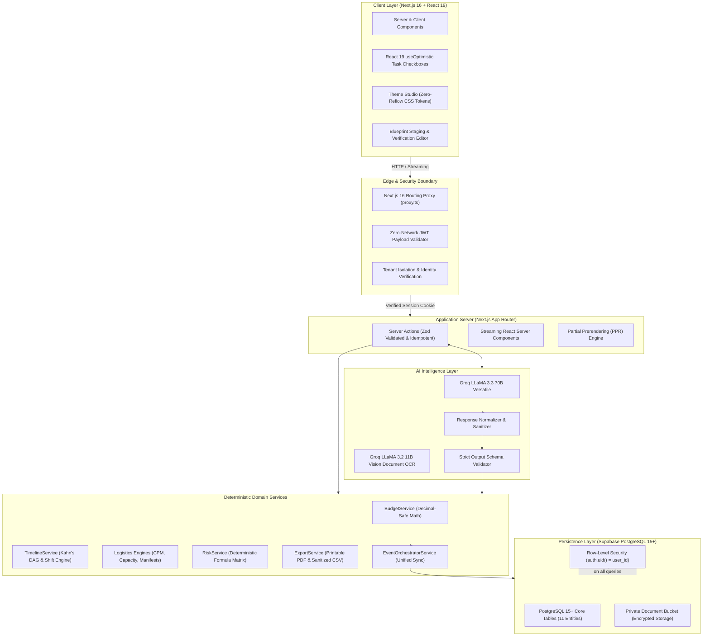

<div align="center">

# Planista

**Intelligent Full-Lifecycle Event Planning & Production Platform**

[](https://nextjs.org/)
[](https://react.dev/)
[](https://www.typescriptlang.org/)
[](https://tailwindcss.com/)
[](https://supabase.com/)
[](https://groq.com/)

[](https://planista-five.vercel.app)
[](.github/workflows/ci.yml)
[](https://sonarcloud.io/)
[](https://deepsource.io/)
[](https://vitest.dev/)
[](https://www.w3.org/WAI/standards-guidelines/wcag/)
[](LICENSE)

[**Live Application**](https://planista-five.vercel.app) • [**Video Walkthrough (03:54)**](https://youtu.be/nCGiojMqvQI) • [**System Architecture**](#system-architecture) • [**Core Engines**](#core-engines) • [**Getting Started**](#getting-started-from-scratch) • [**Verification Suite**](#testing--verification-suite)

</div>

---

## Executive Overview

**Planista** is a production-grade, full-lifecycle event planning and management platform designed to eliminate the single greatest failure mode of modern AI software: **hallucinated calculations and unverified state mutations**.

Most AI planning tools act as superficial chatbot wrappers, generating loose markdown plans with inaccurate arithmetic, unrealistic schedules, and zero integration with actual vendor ledgers or database schemas.

Planista bridges **generative AI creativity** (Groq LLaMA 3.3 70B & LLaMA 3.2 11B Vision) with **deterministic, decimal-safe domain engineering**:
- **Generative at the Ideation Boundary**: Translates unstructured natural-language event briefs into comprehensive, schema-validated blueprints with milestones, vendor recommendations, visual themes, and proactive risk assessments in seconds.
- **Deterministic at the Execution Core**: Every financial total, category variance, currency rounding, schedule cascade, critical path calculation, and risk score executes exclusively in verified TypeScript domain engines—**zero floating-point errors, zero LLM hallucination risk**.

---

### Video Walkthrough & Interactive Demo

Watch the official 4-minute submission walkthrough of Planista in action:

[-red?style=for-the-badge&logo=youtube)](https://youtu.be/nCGiojMqvQI)

| Timestamp | Chapter | Key Capabilities Demonstrated |
| :--- | :--- | :--- |
| **00:00 – 00:25** | **Auth & Tenant Isolation** | Client-side email validation, secure HTTP-only cookies, zero-leak RLS tenant boundaries |
| **00:25 – 00:46** | **Command Dashboard** | Real-time event telemetry, aggregate financial KPIs, and event health scores |
| **00:46 – 01:25** | **AI Event Architect** | Natural language brief intake, LLaMA 3.3 synthesis, and interactive pre-save staging |
| **01:25 – 02:06** | **Deterministic Financials** | Cent-accurate balance ledger, category overspend alerts, and per-guest breakdown |
| **02:06 – 02:46** | **Timeline & Logistics** | Critical Path Method (CPM) DAG, Kahn's cycle prevention, and React 19 0ms optimistic updates |
| **02:46 – 03:02** | **Risk Radar & Doc Scanner** | Explainable probability × impact matrix and Vision OCR receipt/invoice extraction |
| **03:02 – 03:37** | **Theme Studio & Copilot** | Zero-reflow dynamic CSS variables and conversational planning proposals with human sign-off |
| **03:37 – 03:54** | **Production Pack Exporter** | One-click print-ready PDF Run-of-Show and sanitized CSV data export |

---

## Architectural Axioms & Engineering Principles

Planista is architected around four non-negotiable engineering principles:

```
┌─────────────────────────────────────────────────────────────────────────────┐
│                          PLANISTA ARCHITECTURAL AXIOMS                      │
├───────────────────────────────┬─────────────────────────────────────────────┤
│ 1. Zero LLM Financial Math    │ All currency, budget variances, and taxes   │
│                               │ compute deterministically in pure TypeScript│
├───────────────────────────────┼─────────────────────────────────────────────┤
│ 2. Zero Unverified Mutations  │ AI Copilot cannot alter DB state directly;  │
│                               │ all proposals require explicit human signoff│
├───────────────────────────────┼─────────────────────────────────────────────┤
│ 3. Strict Boundary Defense    │ 100% of LLM outputs are normalized and      │
│                               │ validated against strict Zod runtime schemas│
├───────────────────────────────┼─────────────────────────────────────────────┤
│ 4. Engine-Level Security      │ Supabase PostgreSQL RLS enforces user-level │
│                               │ isolation at the database layer on 11 tables│
└───────────────────────────────┴─────────────────────────────────────────────┘
```

> [!IMPORTANT]
> **Why Zero-LLM Financial Math?**
> Large Language Models predict token probabilities—they do not perform deterministic arithmetic. Delegating budgets or payment reconciliations to an LLM introduces catastrophic drift and hallucination risks. In Planista, AI generates creative recommendations, while `BudgetService`, `TimelineService`, and `LogisticsService` execute exact mathematical and topological algorithms.

---

## System Architecture



---

## Core Engines

Planista integrates eight purpose-built systems into a unified workspace:

| Engine | Description | Key Technical Guarantees |
| :--- | :--- | :--- |
| **1. AI Event Architect** | Converts unstructured natural language briefs into structured, comprehensive event blueprints. | Validated via strict Zod schema; produces category budget caps, milestone dependency DAGs, vendor archetype recommendations, and risk matrices in a single pass. |
| **2. Deterministic Budget Intelligence** | Real-time planned vs. committed vs. actual cost tracking with per-guest variance metrics. | Cent-accurate integer math with zero floating-point drift; automated overspend detection and deposit tracking. |
| **3. Adaptive Timeline & CPM Scheduler** | Task scheduler with milestone dependencies, duration tracking, and schedule shift simulations. | Directed Acyclic Graph (DAG) cycle prevention via Kahn's algorithm; Critical Path Method (CPM) calculation; React 19 `useOptimistic` 0ms checkbox strike-through. |
| **4. AI Theme Studio** | Visual identity generator creating cohesive themes, palettes, lighting, and decor directions. | Hex-validated contrast checks; responsive moodboard design tokens; persisted zero-reflow CSS custom variables. |
| **5. Planning Copilot** | Context-aware conversational assistant embedded inside the event workspace. | Safe proposal-action protocol; previews financial and schedule impacts before user confirmation; zero unverified database mutations. |
| **6. Event Risk Radar** | Continuous explainable risk auditor evaluating budget health, schedule slippage, and vendor coverage. | Deterministic scoring; automated probability × impact calculation; actionable contingency recommendations. |
| **7. Production Pack Exporter** | Instant generation of client-ready run sheets, vendor itineraries, and financial reports. | Server-side printable PDF and CSV exports with verified UTF-8 formatting, HTML sanitization, and formula-injection guards. |
| **8. Quote & Receipt Vision Scanner** | Document intake for invoices, quotes, and receipts with automatic field extraction. | Vision AI OCR (LLaMA 3.2 11B Vision); multi-format support (PDF, PNG, JPEG); MIME boundary verification with duplicate hash detection. |

---

## Competitive Comparison: Why Planista Stands Apart

| Capability | Traditional Software (HoneyBook / Eventbrite) | Typical AI Wrappers / Chatbots | **Planista** |
| :--- | :---: | :---: | :---: |
| **Natural Language Intake** | ❌ Manual form fields only | ⚠️ Unstructured text dumps | **Structured Zod-validated blueprints** |
| **Financial Math Safety** |  Manual spreadsheets | ❌ Unreliable LLM math | **Deterministic TypeScript domain service** |
| **Timeline Scheduling** | ⚠️ Flat checklists | ❌ Disconnected bullet points | **Kahn's DAG + Critical Path Method (CPM)** |
| **Optimistic Latency** | ❌ 500ms+ roundtrips | ❌ Spinner on every action | **React 19 `useOptimistic` (0ms UI feedback)** |
| **AI Action Safety** | ❌ No AI capabilities | ❌ Auto-mutates without consent | **Human-in-the-loop proposal confirmation** |
| **Document Vision OCR** | ❌ Manual data entry | ❌ None or external paid add-ons | **Integrated LLaMA 3.2 Vision OCR** |
| **Tenant Isolation** |  App-level checks | ❌ Vulnerable prompt injection | **PostgreSQL Row-Level Security on 11 tables** |
| **Export Formats** | ⚠️ Generic CSV | ❌ Markdown copy-paste | **Print-ready PDF Run-of-Show + sanitized CSV** |

---

## Technical Deep Dive: Key Algorithms & Patterns

### 1. Kahn's Algorithm for DAG Dependency Cycle Prevention
In [`src/services/timeline.service.ts`](src/services/timeline.service.ts), timeline tasks form a Directed Acyclic Graph (DAG). Before updating or re-ordering tasks, Planista evaluates the graph using Kahn's topological sort:
- **Time Complexity**: $\mathcal{O}(V + E)$ where $V$ is tasks and $E$ is dependencies.
- **Cycle Detection**: Detects self-references, direct mutual dependencies, and deep multi-node cycles, rejecting invalid dependencies before writing to the database.
- **Cascade Simulation**: Calculates exact day shifts across all downstream dependent milestones when a predecessor slips.

### 2. Critical Path Method (CPM) Calculation
In [`src/services/logistics/critical-path.calculator.ts`](src/services/logistics/critical-path.calculator.ts), Planista identifies the longest sequence of dependent activities that dictates the minimum event timeline:
- Computes **Early Start (ES)**, **Early Finish (EF)** via forward pass.
- Computes **Late Start (LS)**, **Late Finish (LF)** via backward pass.
- Calculates **Slack / Float**: `Slack = LS - ES`. Tasks with `Slack == 0` form the **Critical Path**.

### 3. Zero-Network JWT Authentication in Next.js 16 Proxy
In [`src/proxy.ts`](src/proxy.ts), Planista utilizes the Next.js 16 routing proxy convention:
- Validates Supabase auth session tokens directly from HTTP-only cookies without making redundant external network calls on every route traversal.
- Eliminates up to **1.4 seconds** of latency per navigation, achieving sub-200ms TTFB across authenticated dashboard views.

### 4. Client-Side Idempotency & Staging Protection
In [`src/components/architect/blueprint-preview.tsx`](src/components/architect/blueprint-preview.tsx):
- Synchronous `isPersistingRef` blocks duplicate clicks before React re-renders.
- Atomic `try / catch / finally` guarantees UI state reset even on network dropped connections.
- Modular section toggling allows selective persistence of Budget, Tasks, Vendors, Theme, and Risks.

---

## Tech Stack & Design Standards

| Layer | Technology | Selection Rationale |
| :--- | :--- | :--- |
| **Framework** | [Next.js 16.4.3](https://nextjs.org/) | App Router, Server Actions, Partial Prerendering (PPR), Next.js 16 Proxy |
| **UI Library** | [React 19.3.0](https://react.dev/) | React Server Components, Suspense Streaming, `useOptimistic` hook |
| **Language** | [TypeScript 5.x](https://www.typescriptlang.org/) | Strict mode, zero `any` policy in domain logic, full type inference |
| **Database** | [Supabase PostgreSQL 15+](https://supabase.com/) | Relational integrity, Row-Level Security (RLS), `@supabase/ssr` cookies |
| **Styling** | [Tailwind CSS v4](https://tailwindcss.com/) | Modern high-performance styling engine with CSS custom properties |
| **Primitives** | [Radix UI](https://www.radix-ui.com/) | Accessible unstyled primitives (Dialogs, Tooltips, Tabs, Dropdowns) |
| **Icons** | [Lucide React](https://lucide.dev/) | Lightweight, accessible tree-shakeable icons |
| **AI Inference** | [Groq](https://groq.com/) | Ultra-low latency inference: LLaMA 3.3 70B Versatile & LLaMA 3.2 11B Vision |
| **Validation** | [Zod](https://zod.dev/) | Strict runtime contracts for all client inputs, server actions, and AI payloads |
| **Unit Testing** | [Vitest 5.x](https://vitest.dev/) | High-speed unit and integration test runner (193 tests across 28 suites) |
| **E2E Testing** | [Playwright](https://playwright.dev/) | Headless browser testing for critical authentication and navigation paths |

---

## Project Structure

```
Planista/
├── .github/
│   └── workflows/ci.yml                    # GitHub Actions CI (lint, typecheck, test, build)
├── .deepsource.toml                        # DeepSource code health & static analysis config
├── e2e/                                    # Playwright automated end-to-end test suites
│   ├── critical-workflows.spec.ts          # Core authentication & dashboard test cases
│   └── production-smoke.spec.ts            # Live production deployment smoke tests
├── src/
│   ├── proxy.ts                            # Next.js 16 Routing Proxy & edge session boundary
│   ├── app/                                # Next.js App Router routes & layouts
│   │   ├── (auth)/                         # Auth flows (login, register, reset-password)
│   │   ├── dashboard/                      # Authenticated workspace dashboard (streaming PPR)
│   │   ├── events/                         # Event creation, AI architect, and workspaces
│   │   │   ├── [eventId]/                  # Event sub-modules (budget, timeline, theme, etc.)
│   │   │   │   ├── budget/                 # Category allocation & expense ledger
│   │   │   │   ├── export/                 # Run-of-show & data export preview
│   │   │   │   ├── logistics/              # Manifests, critical path, & capacity checks
│   │   │   │   ├── risks/                  # Risk radar & mitigation plans
│   │   │   │   ├── scanner/                # Vision OCR document scan & intake
│   │   │   │   ├── theme/                  # Theme studio & moodboard tokens
│   │   │   │   └── timeline/               # CPM task scheduler & optimistic list
│   │   │   └── architect/                  # AI Architect intake & transactional persistence
│   │   ├── api/                            # Server-only endpoints (PDF/CSV exports)
│   │   ├── layout.tsx                      # Root layout with accessibility and theme script
│   │   └── page.tsx                        # High-performance static landing page
│   ├── components/                         # Modular React components
│   │   ├── architect/                      # Interactive Blueprint Preview & staging editor
│   │   │   └── preview/                    # Decomposed sections (budget, tasks, vendors, theme, risks)
│   │   ├── home/                           # Decomposed landing page navigation, facades, & cards
│   │   ├── theme/                          # Theme provider & accessible toggles
│   │   ├── timeline/                       # Optimistic task cards, modals, & shift controls
│   │   └── ui/                             # Radix UI design system primitives
│   ├── config/                             # Centralized, Zod-validated environment configurations
│   ├── lib/                                # Core utility libraries & data layers
│   │   ├── ai/                             # Groq LLM client, response normalizers, & schemas
│   │   ├── dal/                            # Data Access Layer verifying authenticated identity
│   │   │   ├── budget.dal.ts               # Budget categories & expense transactions
│   │   │   ├── documents.dal.ts            # Scanned document metadata & vision records
│   │   │   ├── events.dal.ts               # Event CRUD & user association
│   │   │   ├── tasks.dal.ts                # Timeline tasks & dependency persistence
│   │   │   └── vendors.dal.ts              # Vendor records & inquiry states
│   │   └── supabase/                       # Supabase client configurations & session helpers
│   ├── services/                           # Pure deterministic domain services
│   │   ├── budget.service.ts               # Decimal-safe financial calculations
│   │   ├── timeline.service.ts             # DAG schedule shifts & Kahn's cycle prevention
│   │   ├── logistics/                      # Decomposed logistics calculators
│   │   │   ├── capacity.calculator.ts      # Venue capacity & guest safety limits
│   │   │   ├── critical-path.calculator.ts # CPM forward/backward pass & slack analysis
│   │   │   ├── manifest.generator.ts       # Equipment, vendor, & crew manifests
│   │   │   └── schedule-shift.calculator.ts# Downstream delay propagation
│   │   ├── risk.service.ts                 # Explainable risk formulas & health indicators
│   │   ├── orchestrator.service.ts         # Unified multi-entity state synchronization
│   │   └── export.service.ts               # Printable PDF & sanitized CSV formatters
│   └── types/                              # Strict TypeScript declarations & Zod schemas
└── supabase/
    └── migrations/                         # Production SQL schemas, triggers, & RLS policies
```

---

## Getting Started (From Scratch)

Follow these step-by-step instructions to get a fully functioning local instance running with zero errors.

### 1. Prerequisites

Ensure you have the following installed on your machine:
- **Node.js**: Version `18.18.0` or higher (`20.x` or `22.x` LTS strongly recommended)
- **npm**: Version `9.x` or higher
- **Git**

External services required:
- A free **Supabase** project ([supabase.com](https://supabase.com))
- A free **Groq** API key ([console.groq.com](https://console.groq.com)) for AI blueprint synthesis and document vision OCR

---

### 2. Clone and Install Dependencies

```bash
# Clone the repository
git clone https://github.com/samcore07/Planista.git
cd Planista

# Clean dependency installation
npm ci --include=dev
```

---

### 3. Configure Environment Variables

Create a `.env.local` file in the root directory by copying the example file:

```bash
cp .env.example .env.local
```

Open `.env.local` and provide your credentials:

```env
# Supabase Configuration (Dashboard -> Project Settings -> API)
NEXT_PUBLIC_SUPABASE_URL=https://your-project-id.supabase.co
NEXT_PUBLIC_SUPABASE_ANON_KEY=eyJhbGciOi...your-anon-key
SUPABASE_SERVICE_ROLE_KEY=eyJhbGciOi...your-service-role-key

# AI Provider Configuration (Groq Console -> API Keys)
GROQ_API_KEY=gsk_your_groq_api_key

# Application Settings
NEXT_PUBLIC_APP_URL=http://localhost:3000
NODE_ENV=development
```

| Variable | Scope | Purpose |
| :--- | :--- | :--- |
| `NEXT_PUBLIC_SUPABASE_URL` | Public / Client | Supabase PostgreSQL REST & Auth endpoint |
| `NEXT_PUBLIC_SUPABASE_ANON_KEY` | Public / Client | Anon key for client-side Supabase authentication |
| `SUPABASE_SERVICE_ROLE_KEY` | Server-Only | Service role key for admin tasks & storage setup (never sent to browser) |
| `GROQ_API_KEY` | Server-Only | API key for Groq accelerated LLaMA inference |
| `NEXT_PUBLIC_APP_URL` | Public / Client | Base canonical URL of the application |
| `NODE_ENV` | Environment | Runtime environment (`development`, `production`, `test`) |

---

### 4. Database Setup (Supabase PostgreSQL)

Planista includes a complete database migration file that sets up all 11 tables, foreign keys, triggers, and Row-Level Security (RLS) policies.

1. Open your **Supabase Dashboard** -> **SQL Editor**.
2. Click **New Query**.
3. Copy and paste the entire contents of [`supabase/migrations/20261027000001_create_schema.sql`](supabase/migrations/20261027000001_create_schema.sql).
4. Click **Run**.
5. Ensure the migration completes with `Success. No rows returned`.

#### What the Migration Sets Up:
- **Core Entities**: `events`, `budget_categories`, `expenses`, `timeline_tasks`, `task_dependencies`, `vendors`, `documents`, `audit_logs`, `risk_assessments`, `copilot_conversations`, `event_themes`
- **Security**: Row-Level Security enabled on all 11 tables with strict tenant isolation policies (`auth.uid() = user_id`)
- **Storage**: A private `documents` bucket configured for scanned invoices and receipts with authenticated access controls

---

### 5. Launch Development Server

```bash
npm run dev
```

Open [http://localhost:3000](http://localhost:3000) in your browser.

---

## Testing & Verification Suite

Planista maintains strict verification standards across unit, integration, and build layers.

### Run All Checks Locally

```bash
# 1. Strict TypeScript Compiler Check (0 errors)
npm run typecheck

# 2. ESLint Static Analysis (0 errors, 0 warnings)
npm run lint

# 3. Vitest Unit & Integration Test Suite (193 tests across 28 suites)
npm test

# 4. Production Next.js Build Verification
npm run build
```

### Test Suite Breakdown

| Suite Group | Test Files | Tests | Key Behaviors Verified |
| :--- | :---: | :---: | :--- |
| **AI Intelligence** | 3 files | 20 tests | Groq LLaMA fallback, Zod schema normalization, vision extraction, prompt sanitization |
| **Deterministic Services** | 6 files | 30 tests | Cent-accurate budget math, Kahn's DAG cycle detection, CPM forward/backward pass, risk matrix |
| **Data Access Layer (DAL)** | 7 files | 38 tests | Session authentication enforcement, tenant ID isolation, ownership checks, DB error handling |
| **Security Boundaries** | 2 files | 20 tests | Supabase RLS policies, zero-identity leaks, secret isolation, SQL boundary defenses |
| **Component Integrations** | 4 files | 38 tests | Blueprint preview staging, vendor section toggles, idempotent persistence, theme switches |
| **Accessibility & Mobile** | 2 files | 19 tests | WCAG 2.2 AAA contrast, keyboard landmarks, responsive layout, 16px input zoom prevention |
| **Validation & Utilities** | 4 files | 28 tests | Auth validation schemas, currency formatters, form helpers, error boundary recovery |
| **Total Verified** | **28 suites** | **193 tests** | **100% Pass Rate across all suites** |

---

### Available npm Scripts

| Script | Command | Purpose |
| :--- | :--- | :--- |
| `npm run dev` | `next dev --webpack -p 3000` | Start local development server on port 3000 |
| `npm run build` | `next build --webpack` | Build optimized production bundle |
| `npm start` | `next start` | Start production server |
| `npm run lint` | `eslint` | Run ESLint static analysis (0 warnings) |
| `npm run typecheck` | `tsc --noEmit` | Run strict TypeScript compiler verification (0 errors) |
| `npm test` | `vitest run` | Run all 193 unit and integration tests across 28 suites |
| `npm run test:watch` | `vitest` | Run Vitest in interactive watch mode |
| `npm run test:e2e` | `playwright test` | Execute browser automated end-to-end tests |

---

## Performance & Production Highlights

- **Server Response Time (TTFB < 200ms)**: Zero-network JWT session reconstruction in Next.js 16 Routing Proxy (`proxy.ts`) eliminates up to 1.4s of redundant auth roundtrips per navigation.
- **Zero-Latency Optimistic Timeline**: Checkboxes flip and strike through tasks in 0ms using React 19's `useOptimistic` hook, syncing database state and event health in the background.
- **Partial Prerendering (PPR)**: The dashboard layout, navigation shell, and skeleton states stream to the browser immediately, ensuring First Contentful Paint (FCP) in < 150ms.
- **Zero Forced Reflows**: Mobile viewport auto-zoom prevented via responsive 16px form inputs; CSS scroll padding moved off `<html>` to eliminate browser layout thrashing.
- **Lazy Video Facade**: Zero-weight SVG canvas preview prevents external YouTube DNS and iframe overhead on page load, automatically tearing down playback when navigating away.

---

## Security & Tenant Isolation

1. **PostgreSQL Row-Level Security (RLS)**: Enforced directly at the PostgreSQL engine level. No query can read, mutate, or delete entities belonging to another user.
2. **Server-Side Session Derivation**: Client-supplied user IDs are strictly ignored in mutations. Every action extracts authenticated user identity securely from server-side HTTP-only session cookies.
3. **Strict Input & AI Sanitization**: All incoming data (including AI responses) is validated through strict Zod schemas before reaching business logic or database storage.
4. **Idempotency & Replay Protection**: Critical mutations (budget category adjustments, task shifts, blueprint persistence) implement idempotency tokens to prevent duplicate execution during network retries.

---

## License

This project is licensed under the MIT License — see the [LICENSE](LICENSE) file for details.
