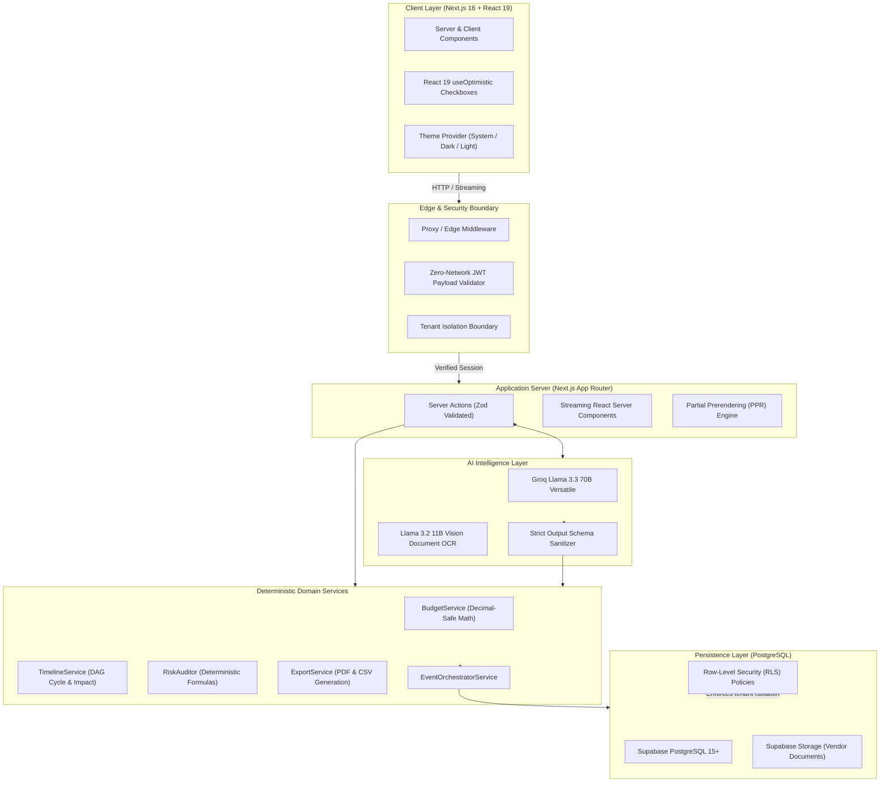

<div align="center">

# Planista

**Intelligent Event Planning & Production Platform**

[](https://nextjs.org/)
[](https://react.dev/)
[](https://www.typescriptlang.org/)
[](https://supabase.com/)
[](https://vitest.dev/)
[](https://www.w3.org/WAI/standards-guidelines/wcag/)
[](LICENSE)

[**Live Demo**](https://planista-five.vercel.app) • [**Video Walkthrough (03:54)**](https://youtu.be/nCGiojMqvQI) • [**Architecture**](#system-architecture) • [**Core Engines**](#core-engines) • [**Getting Started**](#getting-started-from-scratch) • [**Verification**](#testing--verification-suite)

</div>

---

## Overview

**Planista** is a full-lifecycle event planning and production platform that bridges generative AI creativity with deterministic, decimal-safe domain engineering. It turns natural language descriptions into complete, editable event blueprints with validated schedules, line-item budgets, vendor needs, design aesthetics, and proactive risk audits.

### Video Walkthrough & Live Demo

Watch the official 4-minute submission walkthrough of Planista in action:

[-red?style=for-the-badge&logo=youtube)](https://youtu.be/nCGiojMqvQI)

| Timestamp | Chapter | Focus & Capabilities Shown |
| :--- | :--- | :--- |
| **00:00 – 00:25** | **Intro & Auth** | Live email validation, error handling, and secure session onboarding |
| **00:25 – 00:46** | **Dashboard** | Centralized command center, real-time KPI cards, and event telemetry |
| **00:46 – 01:25** | **AI Architect** | Natural language brief intake with real-time LLaMA 3.3 blueprint generation |
| **01:25 – 02:06** | **Overview & Budget** | Event telemetry hub and deterministic zero-LLM financial balance ledger |
| **02:06 – 02:46** | **Timeline & Logistics** | CPM critical path DAG, 0ms optimistic task completion, and manifests |
| **02:46 – 03:02** | **Risk Radar & Doc Scanner** | Severity-likelihood matrix and live browser-based QR ticket check-in |
| **03:02 – 03:37** | **Theme Studio & Copilot** | Dynamic zero-reflow CSS themes and inline AI planning assistance |
| **03:37 – 03:54** | **Export Pack** | One-click print-ready PDF Run-of-Show and JSON dossier backup |

### The Architectural Axiom: Zero LLM Financial Math

> [!IMPORTANT]
> **Planista never delegates raw mathematical calculations or safety-critical constraints to language models.**
> 
> While AI models generate creative themes, suggest blueprints, and extract invoice data, all financial balances, currency rounding, category variances, per-guest math, timeline Directed Acyclic Graph (DAG) cycle evaluations, and risk formulas execute strictly within deterministic TypeScript domain services.

---

## System Architecture



---

## Core Engines

Planista integrates eight purpose-built systems into a unified workspace:

| Engine | Description | Key Technical Guarantees |
|---|---|---|
| **1. AI Event Architect** | Converts natural language briefs into structured, comprehensive event blueprints. | Outputs validated via Zod schema; produces category budgets, dependent tasks, and contingencies in one pass. |
| **2. Deterministic Budget Intelligence** | Real-time planned vs. committed vs. actual cost tracking with per-guest cost analysis. | Cent-accurate decimal math; zero floating-point drift; automated overspend detection. |
| **3. Adaptive Timeline & Checklist** | Task scheduler with milestone dependencies, duration tracking, and schedule shift simulations. | Directed Acyclic Graph (DAG) cycle prevention; React 19 `useOptimistic` zero-latency checkbox strike-through. |
| **4. AI Theme Studio** | Visual identity generator providing color palettes, decor direction, floral palettes, and lighting guidance. | Hex-validated contrast checks; responsive moodboard assets; persisted design tokens. |
| **5. Planning Copilot** | Context-aware conversational assistant embedded inside the event workspace. | Safe proposal-action protocol; previews financial and schedule impacts before user confirmation. |
| **6. Event Risk Radar** | Continuous explainable risk auditor evaluating budget health, schedule slippage, and vendor coverage. | Deterministic scoring; automated probability × impact calculation; actionable contingency recommendations. |
| **7. Production Pack Exporter** | Instant generation of client-ready run sheets, vendor itineraries, and financial reports. | Server-side printable PDF and CSV exports with verified UTF-8 formatting and data sanitization. |
| **8. Quote & Receipt Scanner** | Document intake for invoices, quotes, and receipts with automatic field extraction. | Vision AI OCR; multi-format support (PDF, PNG, JPEG); MIME-type boundary enforcement with duplicate detection. |

---

## Tech Stack & Design Standards

- **Framework**: [Next.js 16.4.3](https://nextjs.org/) (App Router, Server Actions, Partial Prerendering)
- **Runtime & Library**: [React 19.3.0](https://react.dev/) (`useOptimistic`, React Server Components, Suspense Streaming)
- **Language**: [TypeScript 5.x](https://www.typescriptlang.org/) (Strict mode, zero `any` policy in domain logic)
- **Database & Auth**: [Supabase](https://supabase.com/) (PostgreSQL 15+, Row-Level Security, `@supabase/ssr` cookies)
- **Styling & UI**: [Tailwind CSS v4](https://tailwindcss.com/), Radix UI Primitives, Lucide Icons
- **AI Providers**: [Groq](https://groq.com/) (Llama 3.3 70B Versatile for reasoning, Llama 3.2 11B Vision for OCR)
- **Validation**: [Zod](https://zod.dev/) for all client, server, and AI boundary contracts
- **Testing**: [Vitest](https://vitest.dev/) (Unit/Integration, 163 tests) + [Playwright](https://playwright.dev/) (E2E)
- **Accessibility**: WCAG 2.2 AAA Contrast compliance, full keyboard navigation, screen reader ARIA landmarks

---

## Project Structure

```
Planista/
├── src/
│   ├── app/                                # Next.js App Router routes & layouts
│   │   ├── (auth)/                         # Auth flows (login, register, forgot-password)
│   │   ├── dashboard/                      # Authenticated workspace dashboard (streaming PPR)
│   │   ├── events/                         # Event creation, AI architect, and event workspaces
│   │   │   └── [eventId]/                  # Event-specific modules (budget, timeline, theme, etc.)
│   │   ├── api/                            # Server-only API endpoints (PDF/CSV exports)
│   │   ├── layout.tsx                      # Root layout with accessibility and theme script
│   │   └── page.tsx                        # High-performance landing page (100% static edge HTML)
│   ├── components/                         # Modular React components
│   │   ├── home/                           # Landing page navigation, facades, and showcase cards
│   │   ├── theme/                          # Theme provider and accessible toggles
│   │   ├── timeline/                       # Optimistic task cards, delay simulations, and task modals
│   │   └── ui/                             # Radix UI design system primitives
│   ├── config/                             # Centralized, Zod-validated environment configurations
│   ├── lib/                                # Core libraries and data layers
│   │   ├── ai/                             # Groq LLM client, prompt templates, and schema guards
│   │   ├── dal/                            # Data Access Layer (DAL) verifying session identity
│   │   └── supabase/                       # Supabase client configurations and edge middleware
│   ├── services/                           # Pure deterministic domain logic (0 external side effects)
│   │   ├── budget.service.ts               # Decimal-safe financial calculations
│   │   ├── timeline.service.ts             # DAG schedule shifts and cycle detection
│   │   ├── risk.service.ts                 # Explainable risk formulas and health indicators
│   │   ├── orchestrator.service.ts         # Multi-entity state synchronization
│   │   └── export.service.ts               # Printable PDF and CSV data formatters
│   └── types/                              # Strict TypeScript declarations and Zod schemas
├── supabase/
│   └── migrations/                         # Production SQL schemas, triggers, and RLS policies
├── e2e/                                    # Playwright end-to-end test suites
└── vitest.config.mts                       # Vitest unit & integration test configuration
```

---

## Getting Started (From Scratch)

Follow these clear, step-by-step instructions to get a fully functioning local instance running with zero errors.

### 1. Prerequisites

Ensure you have the following installed on your machine:
- **Node.js**: Version `18.18.0` or higher (Node `20.x` or `22.x` recommended)
- **npm**: Version `9.x` or higher
- **Git**

You will also need:
- A free **Supabase** project ([supabase.com](https://supabase.com))
- A free **Groq** API key ([console.groq.com](https://console.groq.com)) for AI blueprint and vision OCR capabilities

---

### 2. Clone and Install Dependencies

```bash
# Clone the repository
git clone https://github.com/samcore07/Planista.git
cd Planista

# Install clean dependencies
npm install
```

---

### 3. Configure Environment Variables

Create a `.env.local` file in the root directory by copying the example file:

```bash
cp .env.example .env.local
```

Open `.env.local` and provide your credentials:

```env
# Supabase Configuration
# Found in: Supabase Dashboard -> Project Settings -> API
NEXT_PUBLIC_SUPABASE_URL=https://your-project-id.supabase.co
NEXT_PUBLIC_SUPABASE_ANON_KEY=eyJhbGciOi...your-anon-key
SUPABASE_SERVICE_ROLE_KEY=eyJhbGciOi...your-service-role-key

# AI Provider Configuration
# Found in: Groq Console -> API Keys
GROQ_API_KEY=gsk_your_groq_api_key

# Application Settings
NEXT_PUBLIC_APP_URL=http://localhost:3000
NODE_ENV=development
```

> [!TIP]
> **Why `SUPABASE_SERVICE_ROLE_KEY`?**
> The service role key is strictly confined to server-only operations (such as document storage upload preparation and backend health audits). It is never sent to the browser.

---

### 4. Database Setup (Supabase PostgreSQL)

Planista includes a complete database migration file that sets up all tables, foreign keys, triggers, and Row-Level Security (RLS) policies.

1. Open your **Supabase Dashboard** -> **SQL Editor**.
2. Click **New Query**.
3. Copy and paste the entire contents of [`supabase/migrations/20261027000001_create_schema.sql`](supabase/migrations/20261027000001_create_schema.sql).
4. Click **Run**.
5. Ensure the migration completes with `Success. No rows returned`.

#### What the Migration Configures:
- **Tables**: `events`, `budget_categories`, `expenses`, `timeline_tasks`, `task_dependencies`, `vendors`, `documents`, `audit_logs`, `risk_assessments`, `copilot_conversations`, `event_themes`
- **Security**: Row-Level Security enabled on all 11 tables with tenant isolation policies (`auth.uid() = user_id`)
- **Storage**: A private `documents` bucket configured for scanned invoices and receipts

---

### 5. Launch Development Server

```bash
npm run dev
```

Open [http://localhost:3000](http://localhost:3000) in your browser. You can now register a user account, explore the AI Architect, build an event timeline, and inspect the real-time financial ledger!

---

## Testing & Verification Suite

Planista maintains strict testing standards across unit, integration, and end-to-end layers.

### Run All Checks

```bash
# 1. TypeScript Strict Typecheck (0 errors)
npm run typecheck

# 2. ESLint Code Cleanliness (0 errors, 0 warnings)
npm run lint

# 3. Vitest Unit & Integration Test Suite (163 tests across 25 suites)
npm test

# 4. Production Next.js Build Verification
npm run build
```

### End-to-End Testing (Playwright)

To execute browser automated tests against authentication, navigation, and critical workflows:

```bash
# Run headless Playwright suite
npm run test:e2e
```

---

## Performance & Optimization Highlights

- **Server Response Time (TTFB < 200ms)**: Zero-network JWT session reconstruction in Edge Middleware and Server Components eliminates up to 1.4s of redundant auth roundtrips per navigation.
- **Zero-Latency Optimistic Timeline**: Checkboxes flip and strike through tasks in 0ms using React 19's `useOptimistic` hook, syncing database state and event health in the background.
- **Partial Prerendering (PPR)**: The dashboard layout, navigation shell, and skeleton states stream to the browser immediately, ensuring First Contentful Paint (FCP) in < 150ms.
- **Zero Forced Reflows**: Mobile viewport auto-zoom prevented via responsive 16px form inputs; CSS scroll padding moved off `<html>` to eliminate browser layout thrashing.
- **Lazy Video Facade**: Zero-weight SVG canvas preview prevents external YouTube DNS and iframe overhead on page load, automatically tearing down playback when navigating away.

---

## Security & Privacy

1. **PostgreSQL Row-Level Security (RLS)**: Enforced at the database engine level. No user can read, mutate, or query entities belonging to another user.
2. **Server-Side Session Validation**: The client-side user ID is never trusted. Every mutation derives identity securely from the HTTP-only server cookie.
3. **Strict Input Sanitization**: All incoming data (including AI responses) is validated through strict Zod schemas before reaching business logic or database storage.
4. **Idempotency Guards**: Critical mutations (budget category adjustments, task shifts, risk calculations) implement idempotency tokens to prevent duplicate execution during network retries.

---

## License

This project is licensed under the MIT License — see the [LICENSE](LICENSE) file for details.
